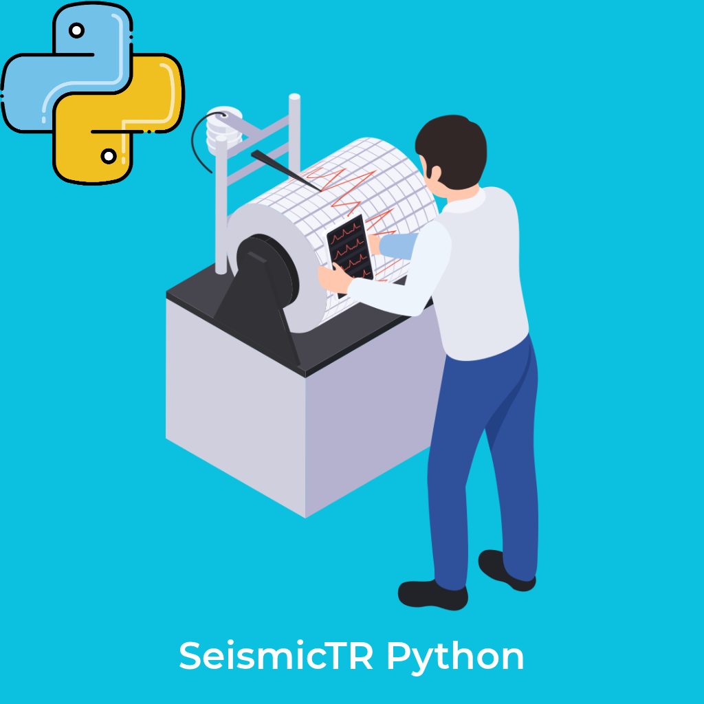

<p align="center">
  
</p>

# 🌍 SeismicTR - Smart Earthquake Early Warning (EEW) Station

[🇬🇧 English](#english) | [🇹🇷 Türkçe](#türkçe)


---

## 📂 Repository Structure / Depo Klasör Yapısı

```text
SeismicTR/
├── Android/          # Android (Flet / Flutter) mobile source & config
├── Windows/          # Windows desktop edition
├── Linux/            # Linux desktop edition
├── README.md
└── LICENSE
```

---

<a name="english"></a>
## 🇬🇧 English

**SeismicTR** is an open-source Earthquake Early Warning (EEW) and seismic monitoring station powered by real-time data from **BDTİM (Kandilli Observatory)**, **EMSC**, **USGS**, and the **IRIS** global seismic network. It calculates P-wave and S-wave arrival times, renders live seismograph waveforms, and delivers high-priority lock-screen alerts.

### ✨ Features
- **Multi-Network Live Data:** Real-time feeds from BDTİM (Kandilli), EMSC (WebSocket), USGS, and IRIS seismic stations.
- **P & S Wave Propagation Simulation:** Expanding P-wave (6.0 km/s) and S-wave (3.5 km/s) circles with real-time countdown timers.
- **Live Seismograph Stations:** Tap any cyan station triangle on the map to inspect real-time BHZ broadband waveforms and PGA values.
- **Smart Lock-Screen & Background Alerts:** Full-screen emergency countdown overlay, silent-mode bypass EEW alarm audio, and high-priority Android notifications for global earthquakes.
- **Automatic Multi-Language (100+ Languages):** Automatically detects the device's system language (built-in Turkish & English, plus automatic cached translation for 100+ languages).

---

### 📱 Android (`Android/` & Releases APK)
- **Minimum:** Android 7.0 (Nougat / API 24)
- **Recommended:** Android 12 or higher (API 31+)
- Pre-built `.apk` files are available in the **[Releases](../../releases)** section.

#### Recommended 5 Settings for Uninterrupted Background Alerts:
1. **Other Permissions:** Enable *Show on Lock screen* and *Open new windows while running in the background*.
2. **Battery Saver / Power:** Select *No restrictions*.
3. **Permissions:** Turn OFF *Pause app activity if unused*.
4. **Notifications & Overlay:** Enable Notifications and *Display pop-up windows / Display over other apps*.
5. **Recent Apps:** Lock / *Keep open* SeismicTR in the Recent Apps screen so it stays active when clearing RAM.

---

### 💻 Windows (`Windows/`)
```bash
cd Windows
pip install -r requirements.txt
python main.py
```

### 🐧 Linux (`Linux/`)
```bash
cd Linux
pip install -r requirements.txt
python3 main.py
```

### ⚠️ Disclaimer
This application is **not** affiliated with any government agency (such as AFAD or Kandilli Observatory). It is an independent, open-source project utilizing publicly available scientific seismic data streams.

---

<a name="türkçe"></a>
## 🇹🇷 Türkçe

**SeismicTR**, **BDTİM (Kandilli Rasathanesi)**, **EMSC**, **USGS** ve **IRIS** küresel sismik ağlarından gerçek zamanlı veri alarak P ve S dalgası varış sürelerini hesaplayan, canlı sismograf grafikleri ve yüksek öncelikli kilit ekranı bildirimleri sunan açık kaynaklı bir Deprem Erken Uyarı (EEW) istasyonudur.

### ✨ Özellikler
- **Çoklu Sismik Veri Ağı:** BDTİM (Kandilli), EMSC (Gerçek Zamanlı WebSocket), USGS ve IRIS istasyon ağından anlık veri akışı.
- **P & S Dalgası Yayılım Simülasyonu:** Deprem merkezinden yayılan P (6.0 km/sn) ve S (3.5 km/sn) dalga çemberleri ve canlı geri sayım sayacı.
- **Canlı Sismograf İstasyonları:** Harita üzerindeki camgöbeği istasyon üçgenlerine dokunarak anlık BHZ genişbant dalga formunu ve PGA değerini izleme.
- **Akıllı Kilit Ekranı ve Arka Plan Uyarıları:** Tam ekran acil durum geri sayım ekranı, telefon sessizdeyken bile çalan EEW alarmı ve dünya genelindeki depremler için yüksek öncelikli Android bildirimleri.
- **Otomatik Çoklu Dil (100+ Dil):** Cihaz sistem dilini otomatik algılama (Türkçe ve İngilizce yerleşik, diğer 100+ dil için otomatik önbellekli çeviri).

---

### 📱 Android (`Android/` & Releases APK)
- **Minimum:** Android 7.0 (Nougat / API 24)
- **Önerilen:** Android 12 ve üzeri (API 31+)
- Hazır kurulum `.apk` dosyalarını **[Releases](../../releases)** sekmesinden indirebilirsiniz.

#### Kesintisiz Arka Plan Uyarıları İçin Önerilen 5 Ayar:
1. **Diğer İzinler:** *Kilit ekranında görüntüle* ve *Arka planda çalışırken yeni pencereler açın* izinlerini açın.
2. **Pil Tasarrufu / Güç:** *Kısıtlama yok* seçeneğini işaretleyin.
3. **İzinler:** *Kullanılmıyorsa uygulama etkinliğini duraklat* anahtarını kapatın.
4. **Bildirimler & Üstte Göster:** Bildirimleri ve *Açılır pencereleri / Diğer uygulamaların üzerinde göster* iznini aktif edin.
5. **Son Uygulamalar:** RAM temizlendiğinde kapanmaması için SeismicTR kartını kilitleyin / *Açık tut* seçeneğini işaretleyin.


### ⚠️ Yasal Uyarı
Bu uygulama resmi bir devlet kurumu (AFAD, Kandilli Rasathanesi vb.) uygulaması **değildir**. Halka açık bilimsel sismik veri akışlarını kullanan bağımsız ve açık kaynaklı bir erken uyarı / izleme projesidir.

---

### 🙏 Credits / Teşekkürler
- Alert sound effects (excluding EEW alarm) are sourced from the open-source **[GlobalQuake](https://github.com/xspanger3770/GlobalQuake)** project.
- Uyarı ses efektleri (EEW alarmı hariç) açık kaynaklı **[GlobalQuake](https://github.com/xspanger3770/GlobalQuake)** projesinden alınmıştır.

